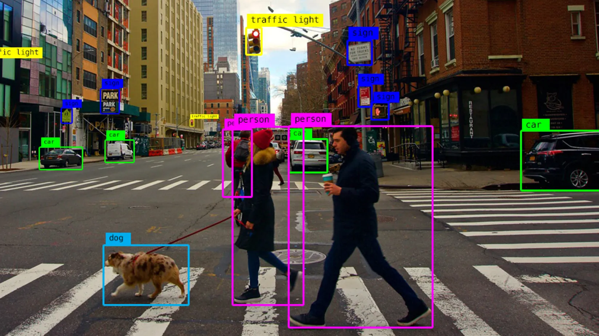

# Project Proposal

AR Project where visual inputs are fed into an LLM that gives arbirarily detailed information about the environment.

## What does it do

The user can look at different parts of the room, looking at the object long enough leads to the agent commenting on the object. At the beginning, the agent is very helpful and informative, and it seems like an useful tool. As time goes on, the agent becomes more predatory and gives you advetisements. At the end, the user gets an eerie feeling.

## Leading questions

- How far can AI research go before it reaches nonesense / hallucination?
    - Are there output patterns of the ai, no matter the visual input
- Soup
- Can too much information lead to subliminal control?
- How long can useful tools exist until they're overrun by advertisements.

## Toolchain

- oculus 3?
- object recognition
- generation of audiovisual output

## Things to play with

- Face recognition
- Nightmare scenario
- Information overflow
- Musical 
- Object Recognition aesthetic

## Next Steps

Set up the pipeline between oculus and leans laptop
Iterative process, try out different ideas and see what works.

## Pitch

In the last few years there have been mutliple attempts at creating ai-assistants that you wear on your body and that react to your environment, with a mixed reception. The google glasses back in 2014, the discontinued Humane AI Pin from 2024, the "Friend" AI necklace and in the last few months the meta glasses.

The most vocal critique is that these devices can be – and more than often are – used as surveillance tools. Surveilance of the users themselves and the surveilance of their environment.

We wondered how such technologies can be used for more whimsical means. We wondered: What can an Agent do with audiovisual input that a human simply can't but maybe wished to do? We thought that our brains filter out much of the information we receive at all times, as not to overwhelm our minds. Much of the stuff we see everyday we don't truly notice. We thought, what if there was a device that could help you point out little details you've missed, that would provide you with interesting infromation about your surroundings, like a personal museum guide? For example, the agent would notice your gace skipping an ordinary plastic chair, and this would prompt it to tell you that the monobloc is the most produced chair of all history, invented in the 1970s by the French Engeneer Henry Massonnet and so on.

Some questions we've asked ourselves are:
    - How would this tool look like, 
    - and could it exist, survive in our current world? 
    - How long could an agent talk about a topic before it just starts talking nonesense, starts hallucinating?
    - How does the framing of information change the perception of the user? If the information provided is framed as a encyclopedia, as an advertisement, as a story?
    - Who controls the framing of the information? The user, a third party, an agent, an institution?

yolo for image recognition